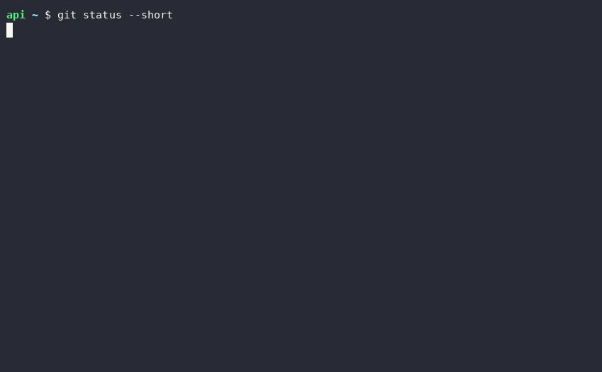

# packdiff

**把一个代码仓库打包成单个、适合喂给大模型的 Markdown 文件 —— 整个仓库，或者只打包你改过的那些文件。**

[](https://github.com/muguang1224/packdiff/actions/workflows/ci.yml)
[](https://pypi.org/project/packdiff/)
[](https://www.python.org/downloads/)
[](#设计取舍)
[](LICENSE)

[English](README.md) · 简体中文



*一个 16 个文件的项目里改了 2 个、新增 1 个；`packdiff --diff -o review.md` 恰好只打包
这 3 个，其余全部不进提示词。*

准备把整个代码库贴给大模型的时候，你大概会卡在这三个问题上：**该放哪些文件？
这一坨到底多少 token？我是不是刚把 `.env` 也塞进去了？**

`packdiff` 一次回答三个问题：遍历仓库，过滤掉噪音和密钥，输出一份干净的
Markdown —— 目录树、语言统计、每个文本文件的代码块，头部还带一个真实的
token 估算值。

```
packdiff . -o context.md                # 打包当前仓库
packdiff --max-tokens 32k -o ctx.md     # 塞进 32k 上下文
packdiff --diff -o review.md            # 或者只要还没提交的改动
packdiff src/ docs/ --include '*.py'    # 只要两棵子树里的 Python
```

## 安装

```bash
pip install packdiff
```

不想装进虚拟环境的话，也可以用 [pipx](https://pipx.pypa.io/)：

```bash
pipx install packdiff
```

需要 Python 3.9 或更高版本。**零依赖**，只用标准库。

## 快速开始

```bash
cd ~/projects/my-service
packdiff
```

````markdown
# packdiff · repository context pack

> Generated by packdiff v0.3.0 on 2026-10-13 10:24 UTC.
> Roots: `my-service`
> 5 files · 103 B · ~215 tokens (estimated)

## Overview

| Language | Files | Lines |
| --- | ---: | ---: |
| markdown | 1 | 3 |
| python | 2 | 3 |
| gitignore | 1 | 2 |
| text | 1 | 1 |

## Directory tree

```text
my-service/
├── src/
│   ├── __init__.py
│   └── core.py
├── .gitignore
├── README.md
└── requirements.txt
```

## Files

### `.gitignore`
```gitignore
.venv/
*.pyc
```

### `README.md`
```markdown
# Demo

A tiny service.
```

### `requirements.txt`
```text
requests>=2.31
```

### `src/__init__.py`
```python
from .core import main
```

### `src/core.py`
```python
def main():
    print("hi")
```

## Skipped as secret-like

Review these before sharing the pack; use `--include-secrets` to override.

- `.env`
````

这就是全部：一份可以直接粘贴、可以 diff、可以缓存、代码变了再重新生成的文档。

## 什么会被打包

包含：所有文本文件，包括 `.github/workflows/ci.yml`、`.gitignore` 这类点文件。

默认排除：

| 类别 | 例子 | 如何关闭 |
| --- | --- | --- |
| 被忽略的路径 | `.gitignore`（含嵌套的）与 `.git/info/exclude` 命中的一切 | `--no-gitignore` |
| 构建产物 | `node_modules/`、`dist/`、`build/`、`target/`、`__pycache__/`、`.venv/`、`vendor/` 等 | `--no-default-ignores` |
| 锁文件 | `package-lock.json`、`poetry.lock`、`Cargo.lock`、`go.sum` 等 | `--no-default-ignores` |
| 二进制文件 | 图片、压缩包、可执行文件、字体、PDF、Office 文档、数据库 | — |
| 二进制内容 | 含 NUL 字节、或无法解码的文件 | — |
| 超大文件 | 超过 `--max-file-size`（默认 1 MiB）的文本 | `--max-file-size 8m` |
| 空文件 | 零字节残留 | — |
| 疑似密钥 | `.env`、`*.pem`、`*.key`、`id_rsa`、`.netrc`、`credentials.json` 等 | `--include-secrets` |

每一处排除都会打印到 stderr，不会有东西悄无声息地消失：

```
$ packdiff
packdiff: 5 files, 103 B from my-service
packdiff: skipped .env: looks like a secret (pass --include-secrets)
```

## 只打包改动过的文件

这个工具最常见的用法其实不是"这是我的仓库"，而是"这是我刚改的东西"。
`--diff` 只打包相对某个版本有差异的文件，并且包含未提交和未跟踪的文件 ——
因为新增的文件本来就是这次改动的一部分：

```bash
packdiff --diff                      # 我还没提交什么？
packdiff --diff main                 # 这个分支比 main 多了什么？
packdiff --diff HEAD~3 -o review.md  # 最近三次提交
packdiff src/ --diff                 # 限制在某个子树里
```

它和其他选项是正交的：改动集合仍然要过 `.gitignore`、二进制检测和密钥过滤。

```bash
packdiff --diff --max-tokens 16k | pbcopy
```

删除文件的行为符合直觉：git 会把删除的文件报出来，但它在磁盘上已经不存在，
自然匹配不到任何内容，于是就不会被打包。没有改动、或者改动全被过滤掉时，你会
拿到一个明确的报错，而不是一份空文档：

```
$ packdiff --diff
packdiff: error: no files changed against 'HEAD'
```

改动检测是直接调 `git diff` 拿结果的，所以它和你刚才 `git status` 看到的完全一致；
而如果机器上没有 git、版本号写错、或者把 `--diff` 指向了仓库外的目录，你会拿到
一句说明原因的错误，而不是悄悄给你一份空包。

## 一份现成的示例

[`examples/demo-project.pack.md`](examples/demo-project.pack.md) 是一个小样例项目
的真实打包结果，提交在仓库里，不用安装就能直接看格式。那个样例目录是特意布置的，
用来展示各种过滤在起作用：`cache/` 和 `debug.log` 被 `.gitignore` 干掉，
`assets/logo.png` 作为二进制被干掉，而 `.env.example` 保留下来 —— 模板不是密钥。

```bash
python3 examples/regenerate.py    # 改过输出格式后重新生成
```

`tests/test_examples.py` 会重新生成这份包并与提交的版本逐字节比对，所以示例不会
悄悄过期。

## Token 预算

`--max-tokens` 让你把包控制在一个上下文窗口内，而不是贴到一半爆掉。

```bash
packdiff --max-tokens 32k -o ctx.md
```

文件按一个明确的优先级顺序入选：先是文件名本身携带架构信号的那些 —— README、
`pyproject.toml` / `package.json`、入口文件（`main.py`、`index.ts` 等）；其余
按体积从大到小，理由是 400 行的模块比 3 行的 `__init__.py` 更能说明这个仓库。
没塞进去的文件会列在文档末尾，而不是被悄悄丢掉：

```markdown
## Deferred by token budget

These files matched but did not fit; raise `--max-tokens` to include them.

- `src/packdiff/walk.py` (11.9 KiB, ~3,049 tokens)
```

第一遍会预留 3% 的预算（至少 120 token）给头部和目录树。但逐个文件的估算无法
预知这两者最终多大，所以文档生成之后会被真实测量，然后逐个推迟最弱的文件并
重新渲染，直到估算值真的落进预算。**`--max-tokens` 是对最终产出的保证，不是
一个愿望。**

### 这个估算准吗？

本仓库**故意不内置 tokenizer** —— 为了一个"零依赖"的命令行工具装一个
200 MB 的词表轮子，显然不划算。估算器的做法是：ASCII 字符按 `1 / 4` token
计（也就是大家熟悉的"4 个字符约 1 个 token"），非 ASCII 字符按 1 字符 1 token
计 —— 这样中文不会被低估四倍。在普通源码上，与真实 BPE 分词的误差大致在
±10% 以内。如果你比经验公式更了解自己的模型，用 `--token-ratio` 调。

## 忽略规则

三层，按顺序生效：

1. **内置黑名单** —— 构建产物与锁文件（`--no-default-ignores` 关闭）。
2. **`.gitignore`** —— 包括嵌套的，每个锚定在自己所在目录；外加 `.git/info/exclude`（`--no-gitignore` 关闭）。
3. **`.packdiffignore`** —— gitignore 语法，从第一个路径的根目录读取，用于放不想提交进仓库的排除项（`--ignore-file` 改路径）。

`--include` 与 `--exclude` 使用同样的 glob 语法，最后生效：

```bash
packdiff --include '*.py'                     # 只要 Python
packdiff --include '*.py' --include '*.toml'  # 可重复，累加
packdiff --exclude 'tests/**' --exclude '*.snap'
packdiff --exclude 'src/**' --exclude '!src/public/**'   # 用取反重新放行
```

支持的 gitignore 语法：`#` 注释、`\#` / `\!` 转义、模式中任意位置的反斜杠转义
（`foo\ bar` 匹配 `foo bar`）、行尾空格裁剪、`!` 取反、结尾 `/` 仅匹配目录、
开头 `/` 锚定、单个路径段内的 `*`、`?`、`[a-z]`，以及作为独立段的 `**`。结尾的
`**` 匹配目录**内部**的一切但不匹配目录本身；其他位置匹配零个或多个目录。
被某个模式命中的目录，其内部全部被排除（无论有没有写结尾的 `/`）。**不支持**
"父目录被排除后再把子文件放行" —— git 自己也不支持，packdiff 通过"直接剪枝不下探"
天然遵守同一条规则。

这是整个工具里唯一"差不多就行"会悄悄给出错误结果的地方，所以它不只有单元测试，
还带一个对照工具（oracle）。拿它跑任何你信得过的仓库，它会告诉你 packdiff 和 git
在哪些路径上看法不一致：

```
$ python3 tools/gitignore_oracle.py /path/to/repo
compared 301 paths: 0 mismatches
```

在本仓库、一个刻意构造的边界用例仓库，以及 Flask、Requests、Express、Click 四个
真实仓库的工作树上，一共比对了上千条路径，零分歧。开发期间它抓出了三个真实 bug
—— 模式内的转义、结尾 `**` 的语义、以及"被命中目录的内部" —— 现在这三条都有
以 git 为准的测试。

## 安全

这个工具的输出，本质上就是你要贴给别人家模型的东西。所以密钥过滤是功能，
不是装饰：`.env`、`*.pem`、`*.key`、`id_rsa`、`.netrc`、`credentials.json`
之类的文件默认跳过，并在日志里点名。模板文件保留：`.env.example`、
`.env.sample`、`id_rsa.pub`。

```bash
packdiff --include-secrets      # 确实需要时才用
```

这是启发式过滤，不能代替你自己看一眼要发出去的内容。

## 命令参考

| 选项 | 默认值 | 说明 |
| --- | --- | --- |
| `PATH...` | `.` | 要打包的文件或目录；多个根目录合并进同一份文档。 |
| `-o, --output FILE` | stdout | 写入 `FILE`，`-` 表示 stdout。 |
| `--max-tokens N` | 不限 | 把包控制在约 `N` token 内，接受 `32k`、`1m`。 |
| `--diff [REV]` | 关 | 只打包相对 `REV`（默认 `HEAD`）有改动的文件，含未提交与未跟踪文件。 |
| `--include GLOB` | — | 只打包匹配的路径，可重复。 |
| `--exclude GLOB` | — | 跳过匹配的路径，可重复。 |
| `--ignore-file FILE` | `.packdiffignore` | 额外的忽略文件，gitignore 语法。 |
| `--no-gitignore` | 关 | 不读 `.gitignore` / `.git/info/exclude`。 |
| `--no-default-ignores` | 关 | 不应用内置黑名单。 |
| `--include-secrets` | 关 | 不跳过疑似密钥的文件。 |
| `--follow-symlinks` | 关 | 下探符号链接目录（带环检测）。 |
| `--max-file-size SIZE` | `1m` | 跳过超过 `SIZE` 的文本文件，接受 `512k`、`8m`。 |
| `--encoding ENC` | `utf-8` | 读取文件使用的编码。 |
| `--token-ratio R` | `4.0` | 估算器中 ASCII 每 token 的字符数。 |
| `--no-tree` | 关 | 不输出目录树。 |
| `--ascii` | 关 | 目录树使用 ASCII 字符（`|--`、`` `-- ``）。 |
| `--list` | 关 | 只列出会被打包的文件，不带内容。 |
| `-q, --quiet` | 关 | 抑制 stderr 摘要。 |
| `--version` | | 打印版本并退出。 |

退出码：`0` 成功，`1` 运行时错误，`2` 用法错误。

## 常见用法

**从命令行直接进剪贴板**

```bash
packdiff src/ --max-tokens 16k | pbcopy            # macOS
packdiff src/ --max-tokens 16k | clip              # Windows
```

**代码评审包** —— 只要这次改动：

```bash
packdiff --diff --max-tokens 60k -o review.md        # 未提交的改动
packdiff --diff main --max-tokens 60k -o review.md    # 整个分支
```

**实现 + 测试，不要别的：**

```bash
packdiff src/ tests/ --include '*.py' --max-tokens 100k -o review.md
```

**可复现的输出**：设置 `SOURCE_DATE_EPOCH` 后头部时间戳会变确定，适合放进
CI 产物或提交进仓库做快照。

```bash
SOURCE_DATE_EPOCH=0 packdiff . -o context.md
```

**先看清成本再决定：**

```bash
packdiff --list          # 每个文件的 token 与字节数
packdiff --list | sort -k2 -n | tail   # 最重的几个文件
```

## 设计取舍

* **零依赖。** 连配置文件都没有引入 TOML 解析器 —— `.packdiffignore` 用的是
  本来就必须实现的 gitignore 引擎。
* **剪枝而非过滤。** 被排除的目录根本不会下探，这让 `node_modules` 上的遍历
  保持快速，也顺带拿到了 git 的"不可反向放行"语义。
* **围栏长度自适应。** 包里如果有一个讨论代码块的 Markdown 文件，固定的
  ```` ``` ```` 会被提前闭合；渲染器会输出比文件内最长反引号串多一个反引号的围栏。
* **Unicode 输出，ASCII 兜底。** 如果输出流编码不了制表符（比如 Windows
  控制台），目录树会自动降级为 `|--` / `` `-- ``。
* **`--diff` 直接问 git，而不是自己猜。** 手写解析索引只是又多一处可能出错的
  地方；`git diff` 本来就知道答案，而且和你一秒前在 `git status` 里看到的一致。

## 开发

```bash
git clone https://github.com/muguang1224/packdiff
cd packdiff
python -m pip install -e ".[dev]"

python -m pytest            # 完整测试套件；不联网，不在磁盘上留 fixture
ruff check . && ruff format --check .

# 可选：用真实 git 校验忽略引擎（需要 PATH 里有 git）
python3 tools/gitignore_oracle.py .

# 可选：重新生成提交在仓库里的示例包
python3 examples/regenerate.py
```

测试用例的目录树在临时目录里现场构造，因此在 Linux、macOS、Windows 上都能
零配置直接跑。

## 许可证

MIT，见 [LICENSE](LICENSE)。
